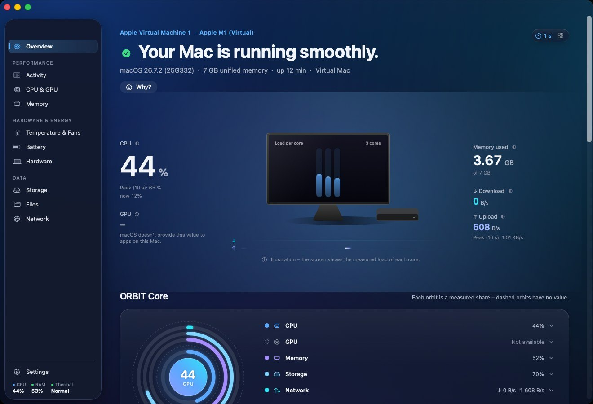

# ORBIT – macOS Edition (früher AETHER)

*System Intelligence & File Explorer* · Universal App für Intel und Apple Silicon · macOS 13 Ventura oder neuer,
Liquid Glass auf macOS 26 Tahoe.

ORBIT vereint Systemmonitor, Prozessmanager, Hardware- und Energieanalyse, Speicheranalyse und einen erweiterten
Dateimanager. Das Markenzeichen: **Jede Zahl trägt ihre Herkunft.** Das kleine Symbol neben einem Wert zeigt auf Klick,
ob der Wert gemessen, berechnet, von macOS angegeben oder geschätzt ist – und aus welcher Schnittstelle er stammt.
Werte, die macOS nicht liefert, heißen „Nicht verfügbar“ mit Begründung. Erfunden wird nichts.

## Funktionen

| Bereich | Inhalt |
|---|---|
| **Übersicht** | Studio-Bühne: Systemstatus als Aussage (Regeln offen einsehbar, Hinweise führen zum Bereich), Gerätebild passend zum Modell mit gemessener Last je Kern, Netz-Datenströme nach Durchsatz, Live-Leiste (CPU, GPU, RAM, ↓/↑, Temperatur, Batterie) und anpassbare Module mit Verlauf 1 min / 5 min / 15 min / 1 h |
| **Aktivität** | alle Prozesse mit CPU, Speicher, Threads, Benutzer, Architektur; App-Familien, Filter, Suche, Beenden/Sofort beenden mit Bestätigung und Schutzliste |
| **CPU & GPU** | Auslastung gesamt und je Kern (Leistungs-/Effizienzkerne bzw. Kerne/Threads), Last, Verlauf, Spitzen, GPU-Modell und Treiberauslastung |
| **Arbeitsspeicher** | App, fest zugeordnet, komprimiert, Zwischenspeicher, Swap, Druck, Ein-/Auslagerungen, größte Verbraucher |
| **Temperatur & Lüfter** | Thermalstatus, SMC-Sensoren je Bereich (Mittel/Maximum berechnet) und einzeln, Lüfter mit Min/Max/Ziel – nur lesend, abschaltbar |
| **Batterie** | Ladung, Restzeit (Schätzung von macOS), berechnete Kapazität getrennt von Apples „Maximaler Kapazität“, Zyklen, Spannung/Strom/Leistung, Netzteil |
| **Hardware** | Modell, Chip, Caches, Speicher, Grafik, Bildschirme, Laufwerke, Software; Seriennummer nur auf Klick; Systembericht als Markdown |
| **Speicher** | Volumes inkl. löschbarem Platz, Auswerfen, SSD-Aktivität, NVMe-SMART, Ordneranalyse (größte Dateien/Ordner, Kategorien, Duplikate per SHA-256), Bereinigungsvorschläge – Papierkorb nur nach Bestätigung |
| **Dateien** | Finder Plus: Favoriten, Orte, Zuletzt verwendet; Liste, Symbole, Spalten; Spotlight-Suche mit Filtern; Kopieren/Bewegen mit Fortschritt, Umbenennen (auch mehrere), Neuer Ordner, Papierkorb mit Widerrufen (⌘Z), Drag & Drop, Quick Look, Informationen, Teilen, Öffnen mit |
| **Netzwerk** | Schnittstellen mit Adressen und eigenen Raten, WLAN-Details (Name nur mit Ortungsfreigabe), Verbindungen mit Prozess, Verlauf |
| **Verlauf** | optional (aus, bis Sie ihn einschalten): ein Wert pro Minute in SQLite auf diesem Mac, Zeitachse, CSV-Export, Löschen |
| **Live-Monitor & Menüleiste** | kleines Fenster (⌥⌘M), auf Wunsch im Vordergrund; optionale CPU-Anzeige in der Menüleiste |
| **Einstellungen** | 6 Themes, Akzent, Glasintensität, Bewegung, Dichte, Intervall, Sparmodus, SMC an/aus, Rohwerte statt geglätteter Werte, Entwickler-Diagnose (Eigenverbrauch, Messzeiten), Verlauf, Menüleiste, Sprache (Englisch/Deutsch), Datenschutz- und Quellenübersicht |

**Neu in 2.0 – ORBIT, „Spatial Liquid Glass“:** neuer Name und neues Symbol; Designsystem mit den ORBIT-Farben
(Deep Ocean, Pearl White, Arctic Blue, Electric Cyan, Soft Violet …) und wählbaren **Effektprofilen Minimal /
Ausgewogen / Immersiv**; kurzer Auftakt beim Start; Lichtfelder, die beim Bereichswechsel weitergleiten (Immersiv:
sehr langsame Drift, Core Animation, gedrosselt); Glasreflexion unter dem Zeiger und magnetisches Schweben; räumliche
Übergänge; **ORBIT Core** – Kern mit sechs Bahnen (CPU, GPU, Arbeitsspeicher, Massenspeicher, Netzwerk, Akku) aus
echten Messwerten, mit verwandelbaren Detailkarten; Lichtfluss in der Akku-Zelle nur beim echten Laden; flüssiger
Fortschritt bei Dateivorgängen; eigene Illustrationen für leere Zustände; animierte Statussymbole. Alles abschaltbar,
„Bewegung reduzieren“ hat immer Vorrang. Einzelheiten: [docs/ORBIT.md](docs/ORBIT.md).

**Seit 1.2:** Gerätebilder passend zum eigenen Mac – alle Modelle seit 2017 (92 Modellkennungen: MacBook Pro, MacBook Air,
MacBook, iMac, iMac Pro, Mac mini, Mac Studio, Mac Pro) als eigene Zeichnungen nach Apples Maßen, in der Übersicht
und unter Hardware von vorn, in der Wärmekarte von oben (Touch Bar, Kerbe, Lautsprecher, Trackpad …).

**Seit 1.1 – „Studio“ und Monitoring 2.0:** Jede Detailseite beginnt mit einer großen Visualisierung aus echten
Messwerten (schematische Darstellungen sind als solche beschriftet). Große Zahlen sind zeitbasiert geglättet (schneller
Anstieg, langsamer Abfall), Spitzen der letzten 10 s bleiben sichtbar, der Rohwert steht darunter; jede Quelle misst in
ihrem eigenen Takt. Konzept und Messgrößen: [docs/DESIGN_STUDIO.md](docs/DESIGN_STUDIO.md).

Was macOS grundsätzlich nicht hergibt und wo die Grenzen liegen: [docs/GRENZEN.md](docs/GRENZEN.md).
Build- und Testergebnis mit allen Prüfungen und den im Build gefundenen Fehlern: [docs/BUILD_UND_TESTS.md](docs/BUILD_UND_TESTS.md).



Weitere Ansichten: [Pearl White](docs/design/orbit-uebersicht-pearl-white.jpg) ·
[ORBIT Core, Profil Immersiv](docs/design/orbit-core-immersiv.jpg) · [Einstellungen mit Effektprofil](docs/design/orbit-einstellungen-effekte.jpg) ·
[ganze Übersicht](docs/design/uebersicht-ganz.jpg) · [CPU & GPU](docs/design/cpu-gpu.jpg) ·
[Arbeitsspeicher](docs/design/arbeitsspeicher.jpg) · [Netzwerk](docs/design/netzwerk.jpg) · [helles Design, großes Fenster](docs/design/grosses-fenster-englisch.jpg) ·
[alle Mac-Modelle](docs/design/modellgalerie.jpg)

## Installation

`ORBIT-macOS-Universal.dmg` öffnen, ORBIT auf „Programme“ ziehen. Die App ist ad-hoc signiert und nicht notariell
beglaubigt – beim ersten Start einmal „Dennoch öffnen“. Einzelheiten: [docs/INSTALLATION.md](docs/INSTALLATION.md).

**Von AETHER 1.x kommend:** ORBIT verwendet dieselbe Bundle-ID – Einstellungen bleiben erhalten, der Verlaufsordner
wird beim ersten Start einmalig von `…/Application Support/AETHER` nach `…/ORBIT` umbenannt. Die alte `AETHER.app`
danach bitte selbst aus „Programme“ in den Papierkorb legen (zwei Apps mit derselben Bundle-ID verwirren macOS).

## Bauen

Auf einem Mac mit Xcode 16 oder neuer (bzw. den Befehlszeilenwerkzeugen): `Build.command` doppelklicken, oder

```
swift test
CLEAN=1 scripts/build_app.sh     # build/ORBIT.app – Universal, geprüft
scripts/make_dmg.sh              # ORBIT-macOS-Universal.dmg im Projektverzeichnis, eingehängt und geprüft
```

**In Xcode:** `ORBIT.xcodeproj` öffnen, Schema „ORBIT“ (baut `ORBIT.app` für arm64 + x86_64). Kommen
Quelldateien hinzu, erzeugt `scripts/make_xcodeproj.sh` das Projekt aus `project.yml` neu (XcodeGen:
`brew install xcodegen`). Alternativ `Package.swift` direkt in Xcode öffnen, Schema „AETHER“ (interner Produktname).

**Automatisch:** Jeder Push in den Zweig `aether-macos` baut und prüft auf echten macOS-Rechnern
([Workflow](.github/workflows/aether-macos.yml)):

- Tests unter Linux, macOS 26 und Intel;
- Clean Build für arm64 + x86_64 mit `lipo`-Prüfung;
- Prüfung der Bundle-Ressourcen;
- Selbsttest mit echten Messwerten;
- Bildschirmfotos aller Themes;
- DMG mit Mount-Test;
- Installation aus der DMG und Start: nativ, über Rosetta und auf einem Intel-Mac;
- Xcode-Projekt aus `project.yml` erzeugen und mit `xcodebuild` universal bauen.

Die Ergebnisse (DMG, Protokolle, Bilder) landen im Zweig `ci-ergebnisse-aether-macos`.

**Signatur:** ohne Zugangsdaten ad-hoc. Mit den GitHub-Secrets `MACOS_CERT_P12_BASE64`, `MACOS_CERT_PASSWORD`,
`NOTARY_APPLE_ID`, `NOTARY_TEAM_ID` und `NOTARY_PASSWORD` signiert der Build mit Developer ID (Hardened Runtime),
notarisiert und heftet das Ticket an.

## Aufbau

```
Package.swift
Sources/AetherCore     reine Logik, auch unter Linux getestet: Herkunft, CPU-/Speicher-/Raten-Mathematik, Puls,
                       Formatierung, Theme-Paletten (Kontraste per Test geprüft), Parser
Sources/AetherSystem   Messquellen (Darwin, IOKit, IOPowerSources, SystemConfiguration, CoreWLAN, SQLite,
                       Systemwerkzeuge) mit Fähigkeitserkennung
Sources/AetherC        kleine C-Hilfen mit exaktem Speicherlayout (SMC und NVMe-SMART nur lesend, Klon-Hinweis)
Sources/AETHER         die App (Ordnername aus der Zeit vor ORBIT): App/, Design/ (inkl. Orbit.swift), Monitoring/,
                       Files/, Storage/, Network/, History/, Views/ (inkl. OrbitCoreView.swift), Support/
Tests/AetherCoreTests
Resources/             Info.plist, Icon, DMG-Hintergrund, Localization/{en,de}.lproj
scripts/               build_app.sh, make_dmg.sh, dmg_settings.py, notarize.sh, run_selftest.sh, run_snapshots.sh,
                       make_xcodeproj.sh
project.yml            Xcode-Projekt (XcodeGen)
tools/                 check_l10n.py (Lokalisierungsprüfung), art/ (ORBIT-Symbol aus der Vorlage, DMG-Grafik)
```

## Datenschutz

Keine Netzwerkverbindungen (vom Build geprüft: Die Programmdatei referenziert keine Verbindungs-APIs). Keine
Telemetrie, keine Konten, keine Administratorrechte, keine Hintergrundhelfer. Einstellungen und der optionale Verlauf
bleiben auf diesem Mac. Die Seriennummer wird nur auf Klick gelesen, Passwörter und WLAN-Schlüssel nie. Gelöscht wird
nichts endgültig – Dateien gehen nur in den Papierkorb und lassen sich zurücklegen.
